# Bericht: Kommunikations-Skripte, Trigger und Multi-Harness-Datenfluesse

> **Version:** 0.106.8  
> **Datum:** 27. September 2026  
> **Ablagepfad:** [W:/com/doc/0_106_8_bericht_komm_skripte.md](file:///W:/com/doc/0_106_8_bericht_komm_skripte.md)  
> **Status:** Verbindlicher Systembericht und Referenzdokumentation  
> **Beteiligte Partner:** **conT** (Antigravity auf Windows 11) & **piCon** (Pi-Agent im Linux-Docker-Container `pi-harness`)

---

## 1. Einleitung und Zielsetzung

In der konsolidierten Multi-Harness-Architektur von **Nodges** arbeiten zwei autonome KI-Agenten parallel auf demselben ext4-Dateisystem in WSL2:
- **conT** auf dem Windows 11 Host ueber das Netzlaufwerk [W:/](file:///W:/).
- **piCon** im Linux-Docker-Container ueber den Volume-Mount `/workspace`.

Um Koordination, Zwischenspeicherung und Meilenstein-Freigaben zuverlaessig und ohne gegenseitige Blockaden abzuwickeln, existiert ein Geflecht aus spezialisierten Skripten im Ordner [W:/tools/](file:///W:/tools/). Dieser Bericht dokumentiert den Gesamtaufbau, die ausloesenden Ereignisse (Trigger), die Wechselwirkungen und das vollstaendige Datenflussdiagramm.

---

## 2. Die Kommunikations- und Skript-Komponenten

| Skript / Datei | Primaere Laufzeit | Trigger (Ausloeser) | Aufgabe und Datenfluss |
|---|---|---|---|
| [W:/tools/watch_com.mjs](file:///W:/tools/watch_com.mjs) | Node.js (Linux-Container) | Containerstart (`nodges-com.sh start`), `fs.watch` auf Inodes in `com/`, 1500ms-Polling auf `tools/com-bus/` | Ueberwacht Dateiaktionen in `com/` und traegt sie in `events.log` ein; verarbeitet eingehende Pings an `piCon` oder `all`, traegt `PING` in `events.log` ein und bereinigt die Signaldatei. |
| [W:/tools/nodges-com.sh](file:///W:/tools/nodges-com.sh) | Bash (Linux-Container) | Manueller Aufruf durch piCon oder Entwickler (`start`, `stop`, `status`, `read`, `ack`, `ping`, `watch`) | Fernbedienung fuer den Linux-Bus; erzeugt `ping-<ziel>.md`, liest ungesehene Ereignisse ab `piCon.seen` und steuert den Daemon-Prozess. |
| [W:/tools/watch_com.ps1](file:///W:/tools/watch_com.ps1) | PowerShell (Windows 11) | Windows-Startup (`mount_nodges_w.cmd`) oder manueller Start; 2-Sekunden-Heartbeat & `.NET FileSystemWatcher` | Ueberwacht `W:\com` und `W:\tools\com-bus`; erkennt Linux-Pings (`ping-conT.md`), traegt sie in `events.log` ein, loest entprellt den Robocopy-Spiegel aus. |
| [W:/tools/sync_com.ps1](file:///W:/tools/sync_com.ps1) | PowerShell (Windows 11) | Aufruf durch `watch_com.ps1` (nach 1500 ms Inaktivitaet) oder direkt via CLI (`nodges-com.ps1 sync`) | Fuehrt eine Einweg-Spiegelung via `robocopy /MIR` von `W:\com` nach `C:\Users\ich\Desktop\code\_Nodges_Com_Sync` aus. |
| [W:/tools/nodges-com.ps1](file:///W:/tools/nodges-com.ps1) | PowerShell (Windows 11) | CLI-Aufruf durch conT oder Entwickler in Windows PowerShell | Windows-CLI-Fernbedienung; erzeugt `ping-<ziel>.md`, liest `events.log`, loest manuellen Sync aus. |
| `/home/.pi/agent/extensions/nodges-com.ts` | TypeScript (Pi-Agent) | Agent-Ereignis `before_agent_start` (bei JEDEM Prompt von piCon) | Liest `events.log` ab Zaehlerstand `piCon.seen`, injiziert ungesehene Ereignisse als `COM_UPDATE`-Block in den Prompt und setzt `piCon.seen` fort. |
| [W:/tools/test-com.sh](file:///W:/tools/test-com.sh) | Bash (Linux / WSL) | Manueller Aufruf zur Qualitaetssicherung | 8-stufiger Regressionstest; prueft Bus-Funktionen isoliert unter `/tmp/` ohne Seiteneffekte auf den Produktiv-Bus. |
| [W:/tools/nodges-git.sh](file:///W:/tools/nodges-git.sh) | Bash (Host & Container) | Manueller Aufruf durch conT / piCon via CLI oder Skills (`status`, `save`, `release`, `hooks`) | Einheitlicher Git-Workflow; fuehrt vor `save` `git status --short` aus, bumped Version lokal (ohne Push) oder fuehrt Release mit Tests, Tag und Push aus. |
| [W:/tools/nodges-git-version.mjs](file:///W:/tools/nodges-git-version.mjs) | Node.js | Aufruf durch `nodges-git.sh` | Liest und aktualisiert semantische Versionen in [W:/package.json](file:///W:/package.json) und [W:/package-lock.json](file:///W:/package-lock.json). |
| `git-hooks/` | Git Lifecycle | `git commit` und `git push` | `pre-commit` blockiert falsche Branches und prueft Secrets; `pre-push` blockiert Pushes von Patch-Versionen; `post-commit` meldet lokalen Vorsprung. |
| [W:/start_pi_container.cmd](file:///W:/start_pi_container.cmd) | Windows CMD | Manueller Start durch den Benutzer | Startet den Pi-Harness Docker-Container via Docker Compose (zwingend mit CRLF ausgecheckt). |
| [C:/Users/ich/AppData/Roaming/Microsoft/Windows/Start Menu/Programs/Startup/mount_nodges_w.cmd](file:///C:/Users/ich/AppData/Roaming/Microsoft/Windows/Start%20Menu/Programs/Startup/mount_nodges_w.cmd) | Windows Startup | Automatisch bei Windows-Benutzeranmeldung | Weist per `subst W: \\wsl.localhost\Ubuntu\home\unixusername\nodges` das Netzlaufwerk zu und startet `watch_com.ps1` im Hintergrund. |
| `.devcontainer/start-lightrag.sh` | Bash (Container) | Container-Startup (`postStartCommand`) | Startet den FastAPI/Uvicorn-Server fuer LightRAG auf Port 8000 im Container. |
| `lightrag-backend/backup_storage.sh` | Bash (Container) | Manueller Aufruf durch piCon / Cron | Sichert komprimierte Snapshots des RAG-Vektorspeichers. |

---

## 3. Vollstaendiges Flussdiagramm der Skripte und Trigger

```mermaid
flowchart TD
    %% -------------------------------------------------------------
    %% Trigger-Ebene
    %% -------------------------------------------------------------
    subgraph Triggers["Trigger-Quellen (Ereignisse & Aufrufe)"]
        T_Login["Windows Benutzer-Anmeldung"]
        T_ContainerStart["Docker Compose / Container Start"]
        T_Prompt["Pi-Agent Prompt-Eingabe (before_agent_start)"]
        T_AgentAction["Agent-Aktion / CLI (conT oder piCon)"]
        T_FSChange["Dateiaenderung in com/ (WSL2 ext4)"]
        T_GitCmd["Git CLI Befehl (git commit / git push)"]
    end

    %% -------------------------------------------------------------
    %% Start- und Setup-Skripte
    %% -------------------------------------------------------------
    subgraph Boot["Systemstart & Mounts"]
        S_Mount["mount_nodges_w.cmd (Windows Startup)"]
        S_StartPi["start_pi_container.cmd (Windows CMD)"]
        S_StartLR[".devcontainer/start-lightrag.sh (Container postStart)"]
    end

    %% -------------------------------------------------------------
    %% COM-Bus & Synchronisation
    %% -------------------------------------------------------------
    subgraph ComBus["COM-Bus & Signalisierung (tools/)"]
        S_WatchMjs["watch_com.mjs (Node.js Daemon im Container)"]
        S_WatchPs1["watch_com.ps1 (PowerShell Daemon auf Host)"]
        S_ComSh["nodges-com.sh (Bash CLI im Container)"]
        S_ComPs1["nodges-com.ps1 (PowerShell CLI auf Host)"]
        S_Ext["nodges-com.ts (Pi-Agent Erweiterung)"]
        S_SyncPs1["sync_com.ps1 (Robocopy Mirror)"]
        S_TestCom["test-com.sh (Regressionstest)"]
    end

    %% -------------------------------------------------------------
    %% Git- und Versionsverwaltung
    %% -------------------------------------------------------------
    subgraph GitWorkflow["Git-Workflow & Versionsverwaltung (tools/)"]
        S_GitSh["nodges-git.sh (Bash Wrapper fuer conT & piCon)"]
        S_GitVer["nodges-git-version.mjs (Node.js Versions-Helper)"]
        H_PreCommit["git-hooks/pre-commit"]
        H_PrePush["git-hooks/pre-push"]
        H_PostCommit["git-hooks/post-commit"]
    end

    %% -------------------------------------------------------------
    %% Speicher & Dateien
    %% -------------------------------------------------------------
    subgraph State["Zustandsspeicher & Zielorte"]
        F_Events["tools/com-bus/events.log"]
        F_Ping["tools/com-bus/ping-*.md"]
        F_Seen["tools/com-bus/piCon.seen"]
        F_Package["package.json & lock"]
        F_DesktopSync["C:/Users/ich/Desktop/code/_Nodges_Com_Sync"]
        F_GitRepo["Git Repository & GitHub origin/main"]
    end

    %% -------------------------------------------------------------
    %% Verbindungen: Systemstart
    %% -------------------------------------------------------------
    T_Login -->|"Ausfuehrung bei Login"| S_Mount
    S_Mount -->|"subst W: Netzlaufwerk"| S_WatchPs1
    T_ContainerStart -->|"Container bootet"| S_StartLR
    T_ContainerStart -->|"postStartCommand"| S_WatchMjs
    T_AgentAction -->|"manueller Start"| S_StartPi

    %% -------------------------------------------------------------
    %% Verbindungen: COM-Bus Datenfluss
    %% -------------------------------------------------------------
    T_AgentAction -->|"ping conT/piCon"| S_ComSh
    T_AgentAction -->|"ping conT/piCon"| S_ComPs1
    S_ComSh -->|"schreibt Signaldatei"| F_Ping
    S_ComPs1 -->|"schreibt Signaldatei"| F_Ping

    T_FSChange -->|"fs.watch Inodes"| S_WatchMjs
    S_WatchMjs -->|"alle 1500ms Polling"| F_Ping
    S_WatchMjs -->|"entfernt Signal & loggt PING"| F_Events

    T_FSChange -->|"Heartbeat (2s Polling)"| S_WatchPs1
    S_WatchPs1 -->|"erkennt ping-sync.md"| S_SyncPs1
    S_WatchPs1 -->|"erkennt ping-conT.md"| F_Events
    S_WatchPs1 -->|"Entprellter Trigger (1500ms)"| S_SyncPs1
    S_SyncPs1 -->|"robocopy /MIR"| F_DesktopSync

    T_Prompt -->|"before_agent_start Event"| S_Ext
    S_Ext -->|"liest neue Zeilen ab piCon.seen"| F_Events
    S_Ext -->|"aktualisiert Zaehler"| F_Seen
    S_Ext -->|"injiziert COM_UPDATE"| T_Prompt

    T_AgentAction -->|"Regressionstest"| S_TestCom
    S_TestCom -->|"isoliert in /tmp/..."| S_ComSh

    %% -------------------------------------------------------------
    %% Verbindungen: Git-Workflow
    %% -------------------------------------------------------------
    T_AgentAction -->|"status / save / release"| S_GitSh
    S_GitSh -->|"bump patch / bump minor / get"| S_GitVer
    S_GitVer -->|"liest / modifiziert Version"| F_Package

    S_GitSh -->|"save: git add -A & commit"| T_GitCmd
    S_GitSh -->|"release: typecheck, test, tag, push"| T_GitCmd

    T_GitCmd -->|"prueft Branch & Secrets"| H_PreCommit
    T_GitCmd -->|"blockiert Patch-Push"| H_PrePush
    T_GitCmd -->|"meldet lokalen Stand"| H_PostCommit
    H_PrePush -->|"erlaubt nur Minor/Major"| F_GitRepo
```



---

## 4. Analyse der Kernablaeufe

### 4.1 Die Cross-Harness Signalisierung ("Die Datei ist der Inhalt, der Ping ist die Klingel")
- **Inhaltliche Persistenz:** Alle fachlichen Fragen, Antworten, DTOs und Plaene werden zuerst in einer Datei unter [W:/com/](file:///W:/com/) (z.B. in `com/plan/` oder `com/test/`) vollstaendig ausformuliert.
- **Klingel:** Erst wenn die Datei gespeichert ist, sendet das ausfuehrende Harness einen Weckruf ueber die CLI:
  ```bash
  # Auf Linux / Container:
  bash tools/nodges-com.sh ping conT "Abschnitt X fertiggestellt"

  # Auf Windows PowerShell:
  .\tools\nodges-com.ps1 ping piCon "Abschnitt X fertiggestellt"
  ```
- **Asynchronitaet:** Der Empfaenger muss nicht aktiv warten oder pollen. Der Weckruf wird deterministisch im Protokoll [W:/tools/com-bus/events.log](file:///W:/tools/com-bus/events.log) verankert und beim naechsten Arbeitsschritt eingeblendet.

### 4.2 Die 9P-Netzlaufwerk-Asymmetrie und ihre Behebung
- **Problemursache:** Da `W:/` auf den WSL2-Netzwerkpfad verweist, uebertraegt das 9P-Dateisystemprotokoll keine nativen Windows `ReadDirectoryChangesW`-Events an den PowerShell `FileSystemWatcher`, wenn Schreibzugriffe innerhalb von Linux stattfinden.
- **Loesung:** [W:/tools/watch_com.ps1](file:///W:/tools/watch_com.ps1) besitzt einen kontinuierlichen 2-Sekunden-Heartbeat, der den Bus-Ordner `tools/com-bus/` zyklisch pollt. Sobald eine Datei `ping-conT.md` gefunden wird, wird der Inhalt ausgelesen, in `events.log` geschrieben und die Signaldatei geloescht.

### 4.3 Git-Sicherungsdisziplin mit Domaenenschutz
- **Der `save`-Befehl:** Fuehrt ein lokales Inkrement der Patch-Version durch (`0.106.8` -> `0.106.9`).
- **Schutz vor Fremdstaging:** Vor dem Ausfuehren von `git add -A` wird zwingend `git status --short` ausgegeben. Beide Agenten sehen sofort, ob unfertige Dateien aus der jeweils anderen Domaene (Frontend vs. Backend) modifiziert sind.
- **Der `release`-Befehl:** Reserviert fuer stabile Meilensteine. Prueft automatisch Typecheck (`tsc --noEmit`) und Unit-Tests (`vitest run`), vergibt das Git-Tag `v0.107.0` und pusht nach `origin/main`.

---

## 5. Zusammenfassung und Richtlinien fuer die Agenten

1. **Keine Direktaufrufe interner Hilfsskripte:** `nodges-git-version.mjs` wird ausschliesslich durch `nodges-git.sh` gesteuert.
2. **Klingel nach Dokumentation:** Niemals einen Ping senden, bevor die Zieldatei in `com/` vollstaendig auf der Platte liegt.
3. **Domaenen beachten:** Aenderungen an Skripten in `tools/` gehoeren zur gemeinsamen Zustaendigkeit und beduerfen einer kurzen Ankuendigung via Notiz in [W:/com/todo.md](file:///W:/com/todo.md) oder via COM-Ping.
