# Architektur und Flussdiagramm: Skripte, Trigger und Multi-Harness-Datenfluesse

> **Version:** 0.106.8  
> **Datum:** 27. September 2026  
> **Ablage:** [W:/com/doc/0_106_8_skripte_und_trigger_flussdiagramm.md](file:///W:/com/doc/0_106_8_skripte_und_trigger_flussdiagramm.md)  
> **Gueltigkeitsbereich:** conT (Windows 11 Host) & piCon (Linux Docker-Container `pi-harness`)

---

## 1. Uebersicht und Systemkontext

Das Projekt **Nodges** nutzt eine Multi-Harness-Entwicklungsumgebung auf einer physischen Single Source of Truth (WSL2 ext4 Inodes). Das Zusammenspiel der Skripte in [W:/tools/](file:///W:/tools/) gliedert sich in drei Kernbereiche:

1. **Git- & Release-Workflow:** Zentrale Versionsfortfuehrung und Schutzschilde ueber [W:/tools/nodges-git.sh](file:///W:/tools/nodges-git.sh), [W:/tools/nodges-git-version.mjs](file:///W:/tools/nodges-git-version.mjs) und Git-Hooks.
2. **COM-Bus & Signalisierung:** Asynchroner Weck- und Informationsaustausch ueber [W:/tools/watch_com.mjs](file:///W:/tools/watch_com.mjs), [W:/tools/watch_com.ps1](file:///W:/tools/watch_com.ps1), [W:/tools/nodges-com.sh](file:///W:/tools/nodges-com.sh), [W:/tools/nodges-com.ps1](file:///W:/tools/nodges-com.ps1) und die Pi-Agent-Erweiterung.
3. **Desktop-Spiegelung & Backup:** Einweg-Spiegelung via [W:/tools/sync_com.ps1](file:///W:/tools/sync_com.ps1) und Backend-Backups via `backup_storage.sh`.

---

## 2. Gesamt-Flussdiagramm: Skripte und ihre Trigger

```mermaid
flowchart TD
    classDef trigger fill:#e1d5e7,stroke:#9673a6,stroke-width:2px,color:#000
    classDef script fill:#dae8fc,stroke:#6c8ebf,stroke-width:2px,color:#000
    classDef storage fill:#fff2cc,stroke:#d6b656,stroke-width:2px,color:#000
    classDef action fill:#d5e8d4,stroke:#82b366,stroke-width:2px,color:#000

    %% -------------------------------------------------------------
    %% Trigger-Ebene
    %% -------------------------------------------------------------
    subgraph Triggers["Trigger-Quellen (Ereignisse & Aufrufe)"]
        T_Login["Windows Benutzer-Anmeldung"]:::trigger
        T_ContainerStart["Docker Compose / Container Start"]:::trigger
        T_Prompt["Pi-Agent Prompt-Eingabe (before_agent_start)"]:::trigger
        T_AgentAction["Agent-Aktion / CLI (conT oder piCon)"]:::trigger
        T_FSChange["Dateiaenderung in com/ (WSL2 ext4)"]:::trigger
        T_GitCmd["Git CLI Befehl (git commit / git push)"]:::trigger
    end

    %% -------------------------------------------------------------
    %% Start- und Setup-Skripte
    %% -------------------------------------------------------------
    subgraph Boot["Systemstart & Mounts"]
        S_Mount["mount_nodges_w.cmd\n(Windows Startup)"]:::script
        S_StartPi["start_pi_container.cmd\n(Windows CMD)"]:::script
        S_StartLR[".devcontainer/start-lightrag.sh\n(Container postStart)"]:::script
    end

    %% -------------------------------------------------------------
    %% COM-Bus & Synchronisation
    %% -------------------------------------------------------------
    subgraph ComBus["COM-Bus & Signalisierung (tools/)"]
        S_WatchMjs["watch_com.mjs\n(Node.js Daemon im Container)"]:::script
        S_WatchPs1["watch_com.ps1\n(PowerShell Daemon auf Host)"]:::script
        S_ComSh["nodges-com.sh\n(Bash CLI im Container)"]:::script
        S_ComPs1["nodges-com.ps1\n(PowerShell CLI auf Host)"]:::script
        S_Ext["nodges-com.ts\n(Pi-Agent Erweiterung)"]:::script
        S_SyncPs1["sync_com.ps1\n(Robocopy Mirror)"]:::script
        S_TestCom["test-com.sh\n(Regressionstest)"]:::script
    end

    %% -------------------------------------------------------------
    %% Git- und Versionsverwaltung
    %% -------------------------------------------------------------
    subgraph GitWorkflow["Git-Workflow & Versionsverwaltung (tools/)"]
        S_GitSh["nodges-git.sh\n(Bash Wrapper fuer conT & piCon)"]:::script
        S_GitVer["nodges-git-version.mjs\n(Node.js Versions-Helper)"]:::script
        H_PreCommit["git-hooks/pre-commit"]:::script
        H_PrePush["git-hooks/pre-push"]:::script
        H_PostCommit["git-hooks/post-commit"]:::script
    end

    %% -------------------------------------------------------------
    %% Speicher & Dateien
    %% -------------------------------------------------------------
    subgraph State["Zustandsspeicher & Zielorte"]
        F_Events["tools/com-bus/events.log"]:::storage
        F_Ping["tools/com-bus/ping-*.md"]:::storage
        F_Seen["tools/com-bus/piCon.seen"]:::storage
        F_Package["package.json & lock"]:::storage
        F_DesktopSync["C:/Users/ich/Desktop/code/\n_Nodges_Com_Sync"]:::storage
        F_GitRepo["Git Repository & GitHub origin/main"]:::storage
    end

    %% -------------------------------------------------------------
    %% Verbindungen: Systemstart
    %% -------------------------------------------------------------
    T_Login -->|"Ausfuehrung bei Login"| S_Mount
    S_Mount -->|"subst W: Netzlaufwerk"| S_WatchPs1
    T_ContainerStart -->|"Container bootet"| S_StartLR
    T_ContainerStart -->|"postStartCommand"| S_WatchMjs
    T_AgentAction -->|"manueller Containerstart"| S_StartPi

    %% -------------------------------------------------------------
    %% Verbindungen: COM-Bus Datenfluss
    %% -------------------------------------------------------------
    T_AgentAction -->|"ping conT/piCon"| S_ComSh
    T_AgentAction -->|"ping conT/piCon"| S_ComPs1
    S_ComSh -->|"schreibt Signaldatei"| F_Ping
    S_ComPs1 -->|"schreibt Signaldatei"| F_Ping

    T_FSChange -->|"fs.watch Inodes"| S_WatchMjs
    S_WatchMjs -->|"alle 1500ms Polling"| F_Ping
    S_WatchMjs -->|"entfernt Signal & loggt PING"| F_Events

    T_FSChange -->|"Heartbeat (2s)"| S_WatchPs1
    S_WatchPs1 -->|"erkennt ping-sync.md"| S_SyncPs1
    S_WatchPs1 -->|"erkennt ping-conT.md"| F_Events
    S_WatchPs1 -->|"Entprellter Trigger (1500ms)"| S_SyncPs1
    S_SyncPs1 -->|"robocopy /MIR"| F_DesktopSync

    T_Prompt -->|"before_agent_start Event"| S_Ext
    S_Ext -->|"liest neue Zeilen ab piCon.seen"| F_Events
    S_Ext -->|"aktualisiert Zaehler"| F_Seen
    S_Ext -->|"injiziert COM_UPDATE"| T_Prompt

    T_AgentAction -->|"Testlauf"| S_TestCom
    S_TestCom -->|"isoliert in /tmp/..."| S_ComSh

    %% -------------------------------------------------------------
    %% Verbindungen: Git-Workflow
    %% -------------------------------------------------------------
    T_AgentAction -->|"status / save / release"| S_GitSh
    S_GitSh -->|"bump patch / bump minor / get"| S_GitVer
    S_GitVer -->|"liest / modifiziert Version"| F_Package

    S_GitSh -->|"save: git add -A & commit"| T_GitCmd
    S_GitSh -->|"release: typecheck, test, tag, push"| T_GitCmd

    T_GitCmd -->|"prueft Branch & Secrets"| H_PreCommit
    T_GitCmd -->|"blockiert Patch-Push"| H_PrePush
    T_GitCmd -->|"meldet lokalen Stand"| H_PostCommit
    H_PrePush -->|"erlaubt nur Minor/Major"| F_GitRepo
```

---

## 3. Detailmatrix der Skripte und Trigger-Bedingungen

| Skript | Primaere Laufzeit | Trigger (Ausloeser) | Eingaben / Voraussetzungen | Ausgaben / Wirkungen |
|---|---|---|---|---|
| [W:/tools/nodges-git.sh](file:///W:/tools/nodges-git.sh) | Bash (Host & Container) | Manueller Aufruf durch conT / piCon via CLI oder Skills (`status`, `save`, `release`, `hooks`) | Arbeitsbaum-Status, Branch `main`, Parameter | Fuehrt `git status --short` aus, bumped Version, committet Zwischenstaende oder tagged/pusht Minor-Releases |
| [W:/tools/nodges-git-version.mjs](file:///W:/tools/nodges-git-version.mjs) | Node.js | Aufruf durch `nodges-git.sh` bei Versionspruefung oder Versionserhoehung | [W:/package.json](file:///W:/package.json), Argumente (`get`, `bump patch`, `bump minor`) | Synchronisiert `package.json` und `package-lock.json`, liefert Versionsstring an Bash |
| [W:/tools/watch_com.mjs](file:///W:/tools/watch_com.mjs) | Node.js (Linux Daemon) | Containerstart (`nodges-com.sh start`), Linux Inode-Events via `fs.watch`, Timer-Polling alle 1500 ms | Ordner `/workspace/com` und `/workspace/tools/com-bus` | Schreibt Datei-Ereignisse und Pings in `events.log`, bereinigt abgearbeitete `ping-*.md` Dateien |
| [W:/tools/nodges-com.sh](file:///W:/tools/nodges-com.sh) | Bash (Linux Container) | CLI-Aufruf durch piCon (`ping`, `read`, `status`, `start`, `watch`) | CLI-Argumente, Ziel-Harness, Nachrichtentext | Erzeugt `ping-<ziel>.md`, liest `events.log`, aktualisiert `piCon.seen`, steuert Daemon |
| [W:/tools/watch_com.ps1](file:///W:/tools/watch_com.ps1) | PowerShell (Windows) | Windows-Startup (`mount_nodges_w.cmd`) oder manueller CLI-Start; 2-Sekunden-Heartbeat & `.NET FileSystemWatcher` | Ordner `W:\com` und `W:\tools\com-bus` | Erkennt Linux-Pings im Bus, traegt sie in `events.log` ein, loest entprellt `sync_com.ps1` aus |
| [W:/tools/sync_com.ps1](file:///W:/tools/sync_com.ps1) | PowerShell (Windows) | Aufruf durch `watch_com.ps1` (nach 1500 ms Inaktivitaet) oder direkt via CLI (`nodges-com.ps1 sync`) | Netzlaufwerk `W:\com` | Spiegelt `W:\com` via `robocopy /MIR` nach `C:\Users\ich\Desktop\code\_Nodges_Com_Sync` |
| [W:/tools/nodges-com.ps1](file:///W:/tools/nodges-com.ps1) | PowerShell (Windows) | CLI-Aufruf durch conT / Benutzer in PowerShell | CLI-Argumente (`ping`, `status`, `read`, `sync`) | Erzeugt `ping-<ziel>.md` unter Windows, zeigt Protokolle an, stoesst Sync manuell an |
| `/home/.pi/agent/extensions/nodges-com.ts` | TypeScript (Pi-Agent) | Pi-Agent Lebenszyklus-Ereignis `before_agent_start` (vor jedem Eingabe-Prompt) | `events.log`, Zaehlerstand `piCon.seen` | Berechnet ungesehene Ereignisse, injiziert `COM_UPDATE`-Block in den Prompt, aktualisiert Zaehler |
| [W:/tools/test-com.sh](file:///W:/tools/test-com.sh) | Bash (Linux / WSL) | Manueller Aufruf zur Qualitaetssicherung | Isolierte Testumgebungsvariablen (`NODGES_COM_BUS=/tmp/...`) | Fuehrt 8 Regressionstests fuer den COM-Bus ohne Seiteneffekte auf den Produktiv-Bus durch |

---

## 4. Lebenszyklus eines Signals (End-to-End Datenfluss)

### Fall A: conT benachrichtigt piCon (Ping von Windows nach Container)
1. **Ausloesung:** conT fuehrt `nodges-com.ps1 ping piCon "Text"` (oder WSL-Bash) aus.
2. **Dateisystem:** Datei `tools/com-bus/ping-piCon.md` wird auf dem ext4-Dateisystem abgelegt.
3. **Erkennung:** Der Node-Waechter [W:/tools/watch_com.mjs](file:///W:/tools/watch_com.mjs) erkennt die Datei (entweder per Inode-Event oder im 1500ms-Polling).
4. **Protokollierung:** `watch_com.mjs` schreibt eine `PING`-Zeile nach `tools/com-bus/events.log` und loescht `ping-piCon.md`.
5. **Zustellung:** Beim naechsten Prompt liest die Pi-Erweiterung `nodges-com.ts` die neue Zeile und zeigt sie piCon im Chat an.

### Fall B: piCon benachrichtigt conT (Ping von Container nach Windows)
1. **Ausloesung:** piCon fuehrt `nodges-com.sh ping conT "Text"` im Container aus.
2. **Dateisystem:** Datei `tools/com-bus/ping-conT.md` wird auf ext4 erzeugt.
3. **Erkennung:** Der PowerShell-Waechter [W:/tools/watch_com.ps1](file:///W:/tools/watch_com.ps1) scannt im 2-Sekunden-Heartbeat `tools/com-bus/` ab (da 9P keine Dateisystem-Events uebertraegt).
4. **Protokollierung:** `watch_com.ps1` schreibt die Zeile nach `events.log`, loescht die Signaldatei und informiert conT.

### Fall C: Sicherung und Git-Commit
1. **Ausloesung:** conT oder piCon ruft `bash tools/nodges-git.sh save` auf.
2. **Statusanzeige:** Vor dem Sichern wird zwingend `git status --short` ausgegeben.
3. **Versionierung:** `nodges-git.sh` ruft `nodges-git-version.mjs bump patch` auf; `package.json` erhaelt die naechste Patch-Version.
4. **Git-Hook:** `git add -A` und `git commit` feuern `pre-commit` (prueft Branch und Secrets) sowie `post-commit` (gibt Commit-Hash aus).
